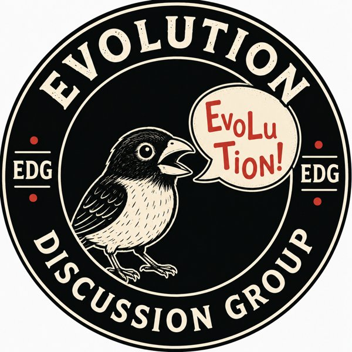

## What is the Evolution Discussion Group?

The Evolution Discussion Group (EDG) is a monthly meeting point for everyone interested in evolution. We discuss new, exciting, and classic papers that explore the questions at the heart of evolutionary biology.

EDG aims to create a social and informal space where students and employees from across the museum can meet, exchange ideas, and learn from each other. No prior expertise is required - everyone is welcome, and no question is too basic. You do not need to have read the paper beforehand to join the discussion; the short introduction at the beginning of each meeting provides enough background to take part.

The meetings are also a chance to take a break from the everyday routine, drink coffee, enjoy some sugar, and get excited about evolutionary biology together.

The group was inspired by the Evolution Discussion Group at the University of British Columbia.

## When and where?

The Evolution Discussion Group meets four times per semester, usually on Thursdays from 13:00-14:00, as part of SNAC/STADIS.

We usually meet in conference room K29 in Lids hus. Come by for a paper, a coffee, and a good discussion!

## How does it work?

At the beginning of each EDG meeting, there is a short introduction to the paper (around 10 minutes), usually presented with a few slides. After that, we drink coffee and discuss the paper together.

The aim of the presentation is to provide a basic introduction to the paper - imagine you are explaining it to biology students who know little about the topic beforehand. The goal is not to give a detailed journal club presentation, but rather to help everyone understand the big ideas and join the discussion.

When preparing the introduction, it can be helpful to think about questions such as:

- What is the big evolutionary question the authors are asking?
- What scientific debate or problem is this paper addressing?
- What approach do the authors use to answer their question?
- What are the main findings?
- Which figures best illustrate the main ideas, and can we explain them together?

The discussion afterwards is where we explore the paper, ask questions, and share different perspectives.

## How do I choose a paper?

Is there a paper or topic within evolutionary biology that you are curious about or want to understand better? Maybe there is a paper that makes you especially excited, challenges your thinking, or has been discussed a lot in the field. Bring it to EDG, and we can discuss it together!

The paper could be:

- A recent publication in a major journal or an evolution-focused journal.
- A research article, perspective, or commentary.
- A paper you have seen discussed widely or recommended by others.
- A classic paper by a well-known evolutionary biologist.
- A paper that has been particularly influential in shaping our understanding of evolution.
- A topic within evolutionary biology where you would like to hear different perspectives.

It is an advantage if the paper has broad interest for evolutionary biologists. In particular, we are interested in papers that help illuminate how evolutionary change is generated - from the interplay between random processes such as mutation and genetic drift, and directed processes such as natural selection and migration, to larger-scale patterns such as adaptation, diversification, speciation, and extinction across ecological and geological timescales.

We welcome contributions across scales, systems, and taxa - from genomes to fossils - united by a shared interest in understanding the mechanisms of evolutionary change.

## Who can present?

Anyone can suggest or present a paper. You can suggest a paper in our shared spreadsheet, and either you - or someone else - can volunteer to present it.

We especially encourage students and postdocs to suggest and present papers. Preparing an EDG presentation is a great way to get deeply into a scientific paper, understand how research articles are constructed, and place a study within the broader scientific debate.

Everyone is welcome - whether you are presenting, asking questions, or simply joining the discussion!

## Previous EDG meetings

### Spring 2026

| Date | Title | Author and year | Presenter |
|------|-------|-----------------|-----------|
| 26.03.2026 | The genomic signatures of evolutionary stasis | Brownstein et al. 2024 | Cassandra Elphinstone |
| 09.04.2026 | Convergence and constraint in the cranial evolution of mosasaurid reptiles and early cetaceans | Bennion et al. 2023 | Lene Liebe Delsett |
| 07.05.2026 | Macroevolution along developmental lines of least resistance in fly wings | Rohner and Berger 2025 | Kjetil Lysne Voje |
| 04.06.2026 | Is the fundamental theorem of natural selection of any use? | Charlesworth 2026 | Siri Birkeland |
