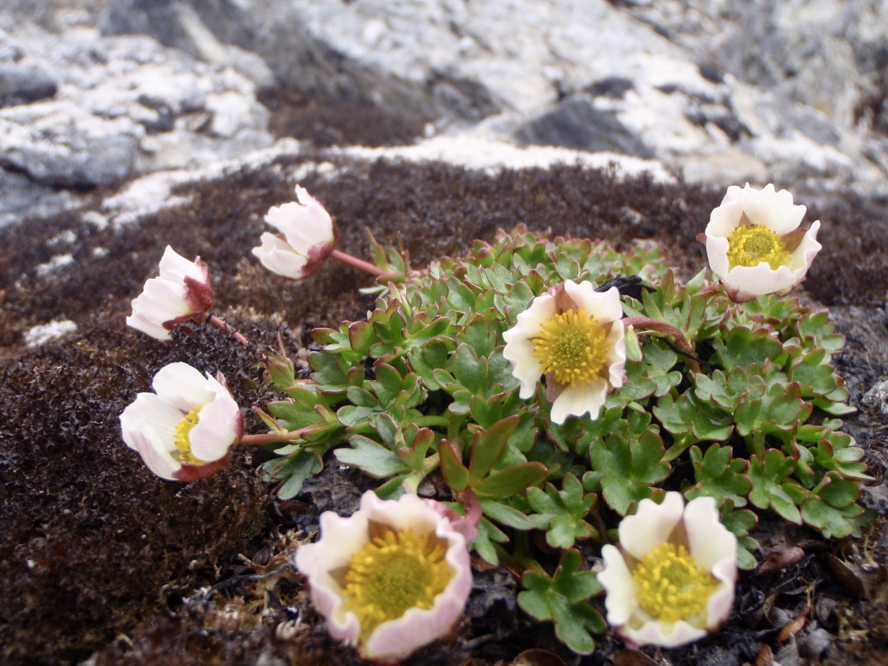
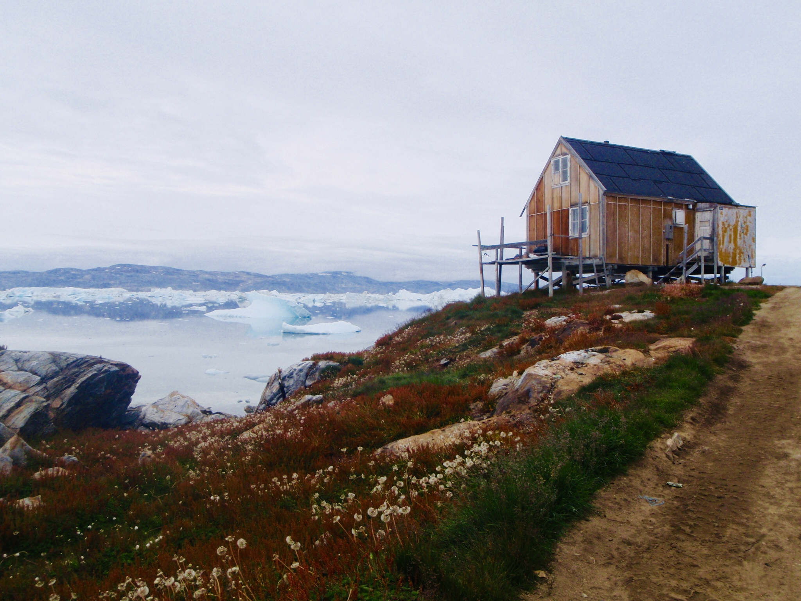
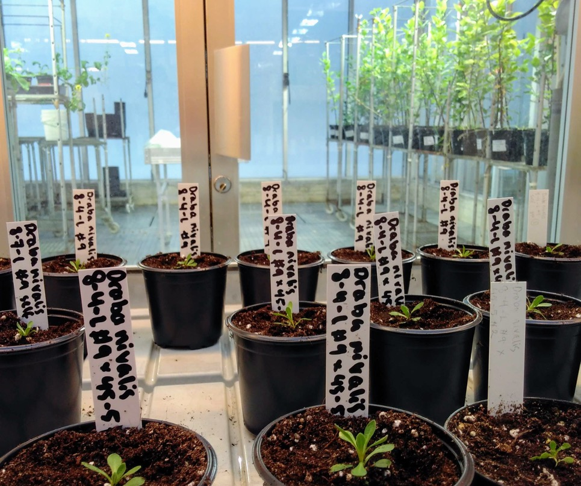

We want to understand how plant diversity arises, and the molecular mechanisms behind it, especially adaptation, speciation and convergent evolution. Much of our work focuses on northern plants, particularly the Arctic-alpine flora.

To study these questions, we combine many approaches: field collections, experimental plant work, population genomics, comparative transcriptomics and phylogenetic comparative methods. We believe there is strength in using several approaches, especially when tackling big evolutionary questions!

As part of a natural history museum, we value collection-based research. The museum's collections give us a unique opportunity to study the past, present and future of plant distributions.

<figure>
  
  <figcaption><em>Ranunculus glacialis</em> (glacier buttercup) in Svalbard</figcaption>
</figure>

## Adaptation of Arctic-alpine plants
We have a special passion for plants that thrive in cold environments! How are some plants able to photosynthesize, grow and reproduce despite low temperatures? How do they endure freezing spells even in the middle of summer? The strong selection pressures imposed by extreme environments tend to leave particularly clear signatures on the genome, which makes it easier for us to deduce the genetic basis of adaptation. These strong selection pressures can even lead to the independent evolution of similar morphological and/or physiological traits in different lineages (i.e. convergent evolution). In this way, extreme environments can function as natural laboratories for studying how different organisms adapt to the same selection pressures, and even bear a slight resemblance to “replaying life’s tape”, as once famously coined by paleontologist Stephen Jay Gould. 

In addition to studying adaptation to current climatic conditions, we are also interested in how Arctic-alpine plants will cope with future climate change. The Arctic is warming at more than twice the global rate, and we are already observing ecological change across the region. Rapid change in combination with limited chance for range displacement make Arctic species especially vulnerable to population reduction and extinction. Increased knowledge on how Arctic species will respond to continued warming is important for making informed conservation decisions, and can be important for policy makers and environmental institutions.

<figure>
  
  <figcaption>Tiniteqilaaq, Greenland</figcaption>
</figure>

## Speciation in Arctic plants
The Natural History Museum in Oslo has been at the forefront of plant speciation genetics for decades. One significant line of research dates back to the 1990s when Professor Christian Brochmann made a startling discovery: interpopulational crosses of the Arctic diploid Draba fladnizensis were completely sterile! This discovery prompted further investigation, revealing that postzygotic reproductive barriers are surprisingly common among many well-defined Arctic plant species, as evidenced by large-scale crossing experiments.

These reproductive barriers appear to have arisen relatively recently, as genetic surveys have indicated low levels of intraspecific genetic differentiation. Moreover, there are no discernible ploidal, morphological, or ecological distinctions between populations. While we are just beginning to understand the drivers behind this rapid speciation, there are indications that it may be linked to mating systems. Notably, many Arctic plants have the capacity for self-fertilization, and recent research suggests that the accumulation of hybrid incompatibilities might be accelerated in selfers.

**In our research group, we aim to unravel the mysteries of speciation in the Arctic and discern the broader implications of these findings for our understanding of speciation mechanisms.**

<figure>
  
  <figcaption><em>Draba nivalis</em> (snow draba) in the greenhouse at the University of Oslo</figcaption>
</figure>

## Convergent evolution 
Convergent evolution is an ubiquitous pattern in nature: In plants, carnivory has evolved independently at least six times in five different angiosperm orders, and photosynthetic pathways that minimize photorespiration, like C4 and CAM photosynthesis, are estimated to have evolved an astonishingly sixty times each. However, it is still unclear to what degree evolution is also repeatable at the genetic level.

We recently investigated whether evolution follows parallel genetic routes when three plant species independently adapted to the extreme temperature and light conditions of the Arctic region. Our primary discovery revealed that despite originating from different lineages, the three species appeared to have evolved similar suites of adaptations by modifying different components in similar stress response pathways. This indicates that there are many genetic trajectories for adaptation to the Arctic environment. The revelation that there might be greater evolutionary repeatability at the pathway level has sparked our keen interest in exploring the convergent evolution of pathways and networks.

  

