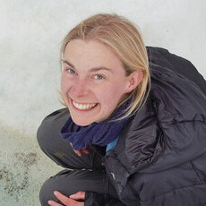
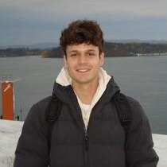
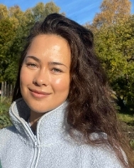
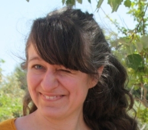
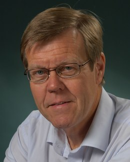
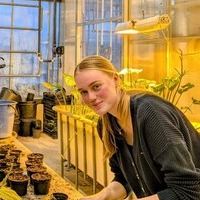
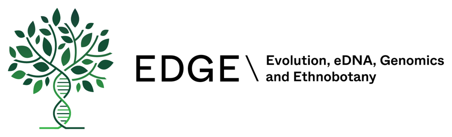

## Current lab members

### Cassandra Elphinstone, Postdoc

Cassandra is a two year NSERC postdoctoral fellow studying the genomics of Arctic plants in the Birkeland lab. She is also collaborating with and will spend about a third of her time in the Todesco Lab at the University of British Columbia in Vancouver, Canada. Her postdoctoral research is exploring the role of structural variation in local adaptation in selfing and outcrossing Arctic species. What types of genomic variation are involved in the local adaptation of plants to diverse tundra environments (single base pair changes and/or larger chromosomal rearrangements)? Does the genomics of local adaptation differ between tundra species that reproduce through self-fertilization (selfing) and species that rely on fertilization from other individuals (outcrossing)?

**E-mail:** [cassandra.elphinstone@gmail.com](mailto:cassandra.elphinstone@gmail.com)

### César Herrero González, Doctoral Research Fellow

César is a PhD candidate studying the genomic basis of plant adaptation to Arctic environments. His research focuses on identifying convergent genomic signatures associated with adaptation to extreme conditions. He previously trained at the Universidad Complutense de Madrid, where he studied climate-driven variation in Mediterranean fir species, and completed his master’s at the Norwegian University of Life Sciences, working on the genomic and epigenomic structure of grasses.

**E-mail:** [c.h.gonzalez@nhm.uio.no](mailto:c.h.gonzalez@nhm.uio.no)

### Lise Grønnerød Huseby, Doctoral Research Fellow

Lise is a PhD candidate interested in the genomic basis of plant speciation and how it is shaped by mating systems. She completed her MSc thesis on the population genetics and ecology of the endangered plant Drymocallis rupestris. She is currently working at NORSKOG.

**E-mail:** [l.g.huseby@nhm.uio.no](mailto:l.g.huseby@nhm.uio.no)

### Marie Kristine Brandrud, Guest Researcher

Marie is interested in genomics and speciation. The Brochmann-group at the Natural History Museum has previously showed an accumulation of redproductive incompatibilities in arctic selfing species, and Marie is currently working to genetically pinpoint those incompatibilities with QTL analysis in *Cochlearia groenlandica*. She also aims to investigate chromosome evolution in *Cochlearia* and will compare the *Cochlearia groenlandica* genome to its sister, *Cochlearia excelsa*, in a collaborative project with the Yant Lab at Nottingham University. 

**E-mail:** [m.k.brandrud@nhm.uio.no](mailto:m.k.brandrud@nhm.uio.no)

### You?

We welcome inquiries from motivated students who share our passion for plants and evolution! I currently have MSc projects available for students interested in plant evolutionary genomics, ecology, and evolution. If you are looking for a potential master project, please get in touch at [siri.birkeland@nhm.uio.no](mailto:siri.birkeland@nhm.uio.no)! 

While I do not currently have funded PhD or postdoctoral positions available, I am happy to support strong candidates who are interested in developing their own fellowship or researcher applications. This includes opportunities such as the [MSCA postdoctoral fellowship](https://marie-sklodowska-curie-actions.ec.europa.eu/actions/postdoctoral-fellowships) and the [Human Frontier Science Program Postdoctoral Fellowship](https://www.hfsp.org/funding/hfsp-funding/postdoctoral-fellowships). We also have postdoctoral opportunities through the [STADIS research hub](https://www.nhm.uio.no/english/research/groups/stadis/) at the Natural History Museum, which are announced on a yearly basis.

## Mentor and Honorary Member

### Christian Brochmann, Professor Emeritus

Christian is Professor Emeritus at the Natural History Museum, University of Oslo, where he led a research group on plant evolution with a special focus on speciation in Arctic plants. His research has spanned the evolution and biogeography of Arctic plants, including phylogeography, polyploid evolution and the history of the Arctic flora. He is an elected member of the Norwegian Academy of Science and Letters and received the University of Oslo's Research Prize in 2009. Christian remains a close mentor and collaborator, and still joins us for discussions and fieldwork, most recently in the Dovre Mountains.

**E-mail:** [christian.brochmann@nhm.uio.no](mailto:christian.brochmann@nhm.uio.no)

## Alumni

### Fenna Sondorp, Intern (2026)

Fenna did her BSc internship with us from Inholland University of Applied Sciences in the Netherlands, working on long-read sequencing of Arctic plants. She successfully defended her thesis in June 2026.

## The EDGE group

Our lab is a part of the [EDGE group](https://www.nhm.uio.no/english/research/groups/edge/) at the Natural History Museum in Oslo. EDGE is an interdisciplinary research group consisting of people working on areas ranging from plant speciation and phylogenomics, the development of metabarcoding as a next-generation biodiversity assessment tool for society, and people's influence on wild plants through use and trade throughout history.   

## Collaborators and friends

- Abel Gizaw - NBIO, Norway  
- Anne Krag Brysting - CEES, University of Oslo, Norway  
- Barnabas Daru - Stanford University, USA  
- Cassandra Elphinstone - University of British Columbia, Canada  
- Christian Brochmann, Natural History Museum, Norway  
- Filip Kolar - Charles University, Czech Republic  
- Johanna Leppälä - Natural Resources Institute, Finland  
- Johannes Daniel Schwarwies - Stanford University, USA  
- José Dinneny - Stanford University, USA  
- Levi Yant - University of Nottingham, UK  
- Loren Rieseberg - University of British Columbia, Canada  
- Lovisa Gustafsson - The University Centre in Svalbard, Norway  
- Lucas Marie-Orleach, CNRS, Université de Tours, France  
- Margret Veltman - Institut de Recherche Pour le Développement, France  
- Marie Kristine Brandrud - Natural History Museum, Norway  
- Nathaniel Street - Umeå University, Sweden  
- Peter Hoitinga - University of Groningen & Inholland University of Applied Science, Netherlands  
- Simen Sandve - Norwegian University of Life Sciences, Norway  
- Sylvain Glemin - CNRS, Université Rennes, France  
- Tanja Slotte - Stockholm University, Sweden  
- Torgeir Hvidsten - Norwegian University of Life Sciences, Norway  

Sources: Silhouette by [Freepik](https://www.freepik.com/free-vector/hand-drawn-question-mark-silhouette_81102255.htm#query=anonymous%20profile&position=6&from_view=keyword&track=ais_user&uuid=0a124e14-628a-4df4-b7ee-81b654165112)
